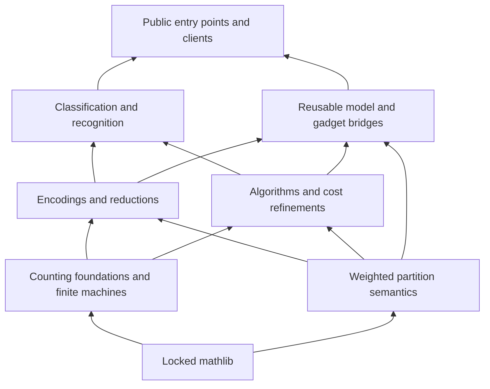

# Architecture

CountingLib separates mathematical models, computation, algorithms, and
classification. Shared definitions have a single source provider. Bridges prove
compatibility between representations rather than replacing them with a single
universal model.

## Layers

Arrows run from a dependency to its users. Core semantic and algorithm interfaces
avoid classification and paper dependencies. Concrete machines may require a
larger computational closure than their mathematical specifications.

| Layer | Main interfaces | Responsibility |
| --- | --- | --- |
| Counting foundations | `Counting.Foundation`, `Counting.Complexity` | Finite counts, witness classes, FP, and parsimonious reductions |
| Representation and execution | `Counting.Encoding`, `Counting.Computation` | Faithful codecs, finite TM2 machines, composition, and encoded runtime |
| Weighted models | `Counting.Model`, `Counting.Gadget` | Ordered occurrences, open partitions, multigraphs, and substitution |
| Algorithms | `Counting.Algorithm` | Executable evaluators, correctness, and explicitly scoped costs |
| Reusable bridges | `Counting.Bridge`, `Counting.Reduction`, `Counting.SharpPClosure` | Value preservation, resource elimination, and complexity transport |
| Classification | `Counting.Flagships` | Stable access to complete research endpoints and their original contracts |

## Public imports

`Counting` is the stable core import. `Counting.Algorithms` adds algorithm and
machine interfaces. `Counting.Reuse` collects ordinary intermediate-tool entry
points; optional `Machine`, `All`, and `Clients` modules expose larger layers.
Each classification has its own flagship import. `Counting.Library` combines
the core, algorithm, ordinary-reuse, and flagship aggregates with selected
machine adapters. Import optional reuse `Machine`, `All`, and client layers
explicitly.

The core import reaches 37 local modules in the accepted snapshot; the algorithm
and reuse imports reach 1,414 and 311 respectively. These are import closures,
not Lake target sizes. The default Lake target is `Counting` and includes some
additional core modules.

## Package ownership

The workspace contains a root package and 37 component packages under
`projects/`. Several packages share the `Counting`, `Holant`, or `PlanarHom`
namespace. Their explicit Lake module claims are disjoint; a module belongs to
one package even when many components import it.

| Component group | Source directories |
| --- | --- |
| Shared Holant definitions | `holant-core`, `tractable-core` |
| Counting and representation | `foundations`, `witness-machines`, `planar-homomorphisms`, `planar-machines` |
| Models and reductions | `partition-semantics`, `graph-csp-reduction`, `counting-cook-levin`, `charged-reductions` |
| Algorithms | `interpolation`, `pfaffian`, `karp-luby`, `variable-elimination`, and their machine or layout refinements |
| Tractable families and transforms | `product-algorithm`, `affine-algorithm`, `holographic` |
| Intermediate tools | `open-network-bridge`, `gadget-reductions`, `field-arithmetic`, `sharpp-closure`, `product-machine-bridge` |
| Classification providers | `holant-unified`, `complex-csp`, `complex-csp-classification`, `planar-classification`, `matchgate-width` |

`holant-core` owns six shared original modules. `tractable-core` owns eighteen
Product/Affine modules at their canonical Lean paths. Legacy Holant file paths
are compatibility symlinks, not additional providers. Product's direct package
dependency on the full Holant package has been removed; the Affine machine layer
still uses that package. This relocation preserves source bytes and contracts;
it does not claim a smaller Lean import closure.

## Representation boundaries

An open instance keeps boundary and hidden variables separate. Its constraints
are an ordered occurrence list with ordered scopes, including repeated variables
and repeated constraints. Partition semantics supports empty domains, isolated
variables, nullary signatures, and zero weights. Multigraph bridges preserve
loops and parallel edges.

Complexity theorems additionally specify a codec, fixed parameters, promises,
and a concrete machine. Natural-valued #P counting and complex-weighted
evaluation have distinct output and reduction contracts. Fixed-language
evaluation and recognition with a language as input have distinct quantifiers.

Read [algorithm contracts](algorithms.md) and [classification scope](flagships.md)
before transporting a semantic equality into a complexity conclusion.
